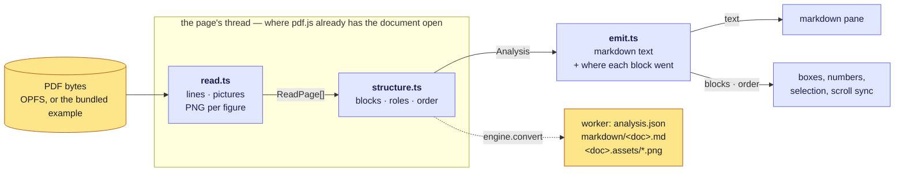

<p align="center">
  
</p>

<p align="center">
  <em>pdf to markdown converter, page by page, your data stays on your machine.</em>
</p>

# mdgest

PDF to Markdown. The one missing feature to [pdf.net](https://pdf.net).

**Why would you need this?** Maybe to use pdf content in LLM prompts or RAG-based pipelines for downstream image and/or text models.

| **Contents**                                                |
| ----------------------------------------------------------- |
| [How it works](#how-it-works)                               |
| [Getting Started](#getting-started)                         |
| [Workspaces and exporting](#workspaces-and-exporting)       |
| [How a page becomes markdown](#how-a-page-becomes-markdown) |
| [Architecture](#architecture)                               |
| [Development](#development)                                 |

---

## How it works

Instead of one function that takes a `.pdf` and returns a `.md`, `mdgest` is an
offline pdf→md tool where a human in the loop can verify the markdown is right,
page by page. Nothing is uploaded anywhere: the conversion runs in your browser,
and the workspace lives in your browser's own storage.

Upload any collection of pdfs:

- a single pdf
- a zip of pdfs
- a folder with pdfs in it

**What every conversion guarantees:**

- all text from the pdf makes it into the markdown
- every picture large enough to be a figure is written beside the markdown and
  linked from it.

Nothing is summarized, rewritten or dropped for being hard to place: a block the
engine cannot make sense of comes out as a paragraph, where you can see it and
fix it.

<p align="center">
  
</p>

Browser storage is evictable and there is no account, so **exporting is what
saving means**. A workspace is a tree in your browser's own storage (at
`workspaces/default/`), and an export of it is a folder on your disk that you
hand back later to carry on where you left off. Nothing in it is hidden.
Folders are yours to organize however you like — mdgest mirrors them. Say you
upload an `invoices` folder to mdgest with `invoice1.pdf` inside it.

    <workspace>/
      mdgest.json                              the manifest: each document's SHA-256 and every decision
      sources/invoices/invoice1.pdf            the source PDF, untouched
      markdown/invoices/invoice1.md            the output, same tree
      markdown/invoices/invoice1.assets/       its figures, as PNGs
      .mdgest/invoices/invoice1.pdf/
        analysis.json                          the engine's read of the PDF (blocks, fonts, roles) — regenerable until it has edits
        edits.json                             your corrections, whether it is done, and its undo history

Every edit is written to `edits.json` as it is made; there is no save button.

**Formatting and Edit features:**

- pdf -> md - `pdf.js` reads every line and picture, `structure.ts` determines reading order and formatting, `emit.ts` writes the markdown.
- toggle - click to select, `shift`-click for a range, `ctrl`/`cmd`-click for distinct blocks, click away or `esc` deselects.
- format - toggle blocks and set their formatting from the floating toolbar.
  - heading level (**H1**, `#`), (**H2**, `##`), (**H3**, `###`), (**H4**, `####`)
  - ¶ paragraph (plain text)
  - > Blockquotes
  - lists (unordered: `-`, numbered: `1.`, alpha: `a.`, roman: `i.`)
    - we do not yet support capital alphabetical or roman lists.
    - this could be implemented so when a user hovers over the `a.` or `i.` in the toolbar, a capital `A.` and `I.` show above the respective buttons.
    - this would be similar to the iphone keyboard feature where you press and hold on a key and then special letters come up above it.
  - Indentation (for lists only) - mdgest allows left and right indentation
  - **bold**
  - _italic_
  - insert page break (`---`) before or after selected block
  - hide (writes the block content in a `<!-- markdown comment -->`)
  - delete (omits block content from going into markdown at all)
  - join (two or more consecutive blocks)
  - divide (one block at a time; you decide where to split.)
- edit - raw markdown; free text. _apply_ checks formatting and saves changes. Revert with one undo.
- Undo with `ctrl`+`z`
- Redo with `ctrl`+`shift`+`z` or `ctrl`+`y`
- Revert to original to drop every edit and read the PDF again
- control page numbers and repeated headers and footers: keep them as text (the default), hide them as comments, or delete to keep them out of markdown.
- mark done, which locks a document until it is reopened
- export workspace (includes rules from edits made and pdf sources) or just the markdown as a zip or folder
- a guided tour on a bundled two-page example, so none of this has to be learned on your own document

**Not built yet** — in the order they matter

|                  |                                                                                                        |
| ---------------- | ------------------------------------------------------------------------------------------------------ |
| cross out        | ~~strikethrough~~ option in floating toolbar. Needs to click and drag to highlight text.               |
| task Lists       | Use - [ ] for unchecked boxes and - [x] for checked boxes.                                             |
| mutable indices  | click-and-drag to reorder or click and edit index                                                      |
| tables           | convert to markdown table syntax                                                                       |
| code             | `inline_code()` and ```<language> multi-line code                                                      |
| math             | Needs research. Markdown supports latex. `$...$`                                                       |
| images           | drag corners to resize height / width; choose left, center, right placement; rotate                    |
| mermaid diagrams | https://mermaid.ai/open-source/intro/ for different diagrams. Simple one to start: DAG (detect arrows) |
| `rules.json`     | what the engine learns from a folder's documents (biggest design piece left)                           |

> Note to self: Do we need any tooling for table of contents and configuring those?
> Maybe [^1] for footnotes?

---

## Getting Started

```bash
git clone https://github.com/roest1/mdgest.git && cd mdgest
curl -fsSL https://bun.com/install | bash
bun install
bunx playwright install --with-deps chromium   # once, for bun run test
bun run dev          # http://127.0.0.1:2048, or set WEB_PORT
```

`bun run lint` (oxlint), `bun run typecheck` (`tsc -b`), `bun run test`
(vitest in headless Chromium, [tests/README.md](tests/README.md)) and `bun run build` (`tsc -b`
then vite) are what CI runs, in that order, after
`bun install --frozen-lockfile`, on every push to `main` and every pull
request.

---

## Workspaces and exporting

### Exporting

**Export**, in the editor's header, writes the workspace out as a zip on any
browser, or straight into a folder you pick on Chromium ones:

    my-project/
      mdgest.json          every document's hash and decisions, in one file
      sources/             the PDFs, exactly as they went in
      markdown/            each document marked done, with its figures

A markdown-only export writes `markdown/` alone. Markdown is written for done
documents only, so nothing half-finished goes out looking finished. Into a
folder, the folder must be empty or one an earlier export wrote; what that
export wrote is replaced, and nothing else there is touched.

`mdgest.json` gathers each document's `edits.json` into one file, each entry
checked on its own — `src/lib/exchange.ts` documents the format and what an
import does with a changed, damaged, or other-reader entry.

### Adding, continuing, and replacing

Everything you drop — PDFs, folders, zips — is listed before anything is
written: an earlier export (recognized by its `mdgest.json`) continues where
it left off, new PDFs join the one workspace this browser keeps, and a
revised PDF starts over, because edits are keyed to block positions. The
marks a row can carry are `src/lib/protocol.ts`'s `Status`; what committing
each one does, `src/lib/stage.ts`.

### Rules: what gets learned

_Designed, not built — the `rules.json` row of the roadmap._

A rule maps how a block looks on the page — font size, weight, indent, marker — to the role you decided it should have. Not the text, the shape: "14pt bold, indent 2 → heading level 2." Text rules are in the design too, for repeated headers and footers, keyed by wording with digits wildcarded so page numbers don't break the match — the per-document detection is already built (_Where fidelity is still missing_, below); what a rule adds is carrying the choice across a folder.

Rules are learned when you mark a document **done**, not on every edit. A heading level you try and undo on page 2 never touches `rules.json` — only your final, confirmed edits do. The one exception is hiding a repeated line at folder scope, which is deliberately explicit and shown across every occurrence before you commit. When rules apply, the deepest matching folder wins, and your own `edits.json` always overrides whatever a rule guesses.

The payoff: the second document in `invoices/` that shares a template edits faster than the first — headings, footers, and boilerplate that formatted the same way get recognized before you touch them. And because a rule is a plain, readable JSON entry with an example block attached, you can see exactly why the engine made a call, and delete or override any single rule without retraining anything.

---

## How a page becomes markdown

Three files, one direction, no model — and `convert.ts` as the conductor: one
reading per document at a time, the engine's cached `analysis.json` used when
there is one, and the result put in the store for both panes.



`read.ts` and `structure.ts` run on the page's thread, because that is where
pdf.js has the document open and where a canvas exists to draw a figure into
(_Where it runs_, below). `emit.ts` is pure and runs on both sides: the worker
calls it to write `markdown/<doc>.md`, and the page calls it to know which
source lines a block became — so the numbered boxes on a page and the numbered
lines beside them are one list by construction, not two lists kept in step.

**Why pdf.js.** It was chosen over pdfium by measurement: over four documents
it reproduced the reference markdown byte for byte, and where the two
disagreed — nine lines — pdfium was wrong every time.

**The frame.** Everything downstream of `read.ts` is in PDF points, in each
page's own frame at scale 1, origin top-left, y down — what
`getViewport({ scale: 1 })` lays out, with the page's rotation already applied.
A box in an analysis is where a person sees the thing, which is what lets the
page pane draw it by multiplying by the zoom and nothing else.

The decisions themselves — how runs become lines, lines become blocks, blocks
get roles and an order, and what each one is written as — are documented where
they are made: the constants and comments of `read.ts`, `structure.ts` and
`emit.ts`.

### Where fidelity is still missing

Every decision the reader makes is a _default_, and every default is a guess a
person should be able to overrule. That is `edits.json`: the analysis is
regenerable from the PDF — and kept once made — and the markdown regenerates
from the analysis and the edits. The roadmap under _How it works_ lists
features to build; this is
what the reader gets wrong today, and what fixing it would take.

**Page furniture** is the clearest case. `furniture.ts` finds what a page
prints in its margins that is not the document: a page number, or a wording
repeated on two or more pages, digits wildcarded so `Page 3 of 40` matches its
own kind — position decides before wording. Each kind is a per-document
setting, kept as text (the default), hidden as a comment, or deleted, applied
where the markdown is written: no block moves and the reader is untouched.

Beyond that, what a conversion cannot yet get right — a gap with a test case
named beside it is drawn as an expected failure in the suite
([tests/README.md](tests/README.md)):

| gap                                                                      | what comes out today                                                                                                            | what it would take                                                                                                                                              |
| ------------------------------------------------------------------------ | ------------------------------------------------------------------------------------------------------------------------------- | --------------------------------------------------------------------------------------------------------------------------------------------------------------- |
| **tables**                                                               | the cells as separate blocks, in XY-cut order — usually one paragraph per cell                                                  | a ruling/alignment pass over a band: detect the grid from line boxes and drawn rules, then emit a GFM table. `remark-gfm` already renders them                  |
| **math**                                                                 | the glyphs as printed, so a fraction comes out as its numerator and denominator on two lines                                    | recognizing math runs by font (the `CM`/`STIX`/`MS` families) and layout, then emitting `$…$`. This is the hardest one                                          |
| **hyphenation**                                                          | a word broken across two lines stays broken                                                                                     | joining `-` at a line end when the next line continues lowercase — safe in prose, wrong in code and in compound terms, so it wants to be an edit, not a default |
| **rotate**                                                               | the page's own rotation is applied; a block cannot be turned                                                                    | a per-block override in the edits, and a reading pass over sideways text                                                                                        |
| **reading order across pages**                                           | each page is cut on its own, so a paragraph spanning a page break is two blocks until a person joins them                       | a rule for continuation                                                                                                                                         |
| **columns under a full-width line** (`blocks-two-columns-under-a-title`) | two columns between a title and a footer that span the gutter are read across, row by row, where their paragraph breaks line up | cutting on the gutter where it runs, not only where it crosses the whole region                                                                                 |
| **first-line indents** (`blocks-first-line-indent`)                      | paragraphs told apart only by an indented first line, as books and papers set them, run together                                | reading an indented line after a full-width one as a new paragraph                                                                                              |
| **long lettered lists** (`lists-lettered-past-h`)                        | `i.` after `h.` is read as the numeral one, and the count restarts there                                                        | judging an ambiguous marker by the items around it                                                                                                              |
| **ZapfDingbats bullets** (`lists-dingbat-bullets`)                       | a bullet in that face comes through pdf.js as a letter (`l` for ●) and stands apart from its item                               | remapping that face's codes the way Wingdings' are                                                                                                              |

Each of these is a fidelity feature, not a rewrite: they add roles and
attributes to `Block`, and lines to `emit.ts`. The frame, the ids and the cache
do not move.

--

## Architecture

### Tech stack

**the app** — one bundle, hosted as static files on Cloudflare Pages. No server,
no account, and no request to any other origin: what it fetches after the page
loads — the editor, pdf.js's worker and data, the tour — is its own.

|          |                                                                                                                    |
| -------- | ------------------------------------------------------------------------------------------------------------------ |
| build    | `vite` 8 (rolldown), `typescript` 7, `oxlint`                                                                      |
| ui       | `react` 19, `react-router` 8, `tailwind` 4, `lucide-react` icons                                                   |
| state    | `zustand` — one store for what both editor panes read                                                              |
| pdf      | `pdfjs-dist` 6 — its assets shipped same-origin (_What the boundaries are_, below)                                 |
| markdown | `react-markdown` + `remark-gfm` for the rendered view                                                              |
| archives | `fflate` — unzip on the way in, zip on the way out                                                                 |
| fonts    | Literata (serif), Geist Sans (ui), JetBrains Mono (code), Caveat (the tour's hand) — self-hosted via `@fontsource` |

**pdf.js reads the PDF.** Every line with its box, size and weight, and every
picture with the bounds it was drawn to. It was chosen over pdfium by
measurement, not preference (_How a page becomes markdown_, above).

**OPFS is the workspace.** The origin-private file system is the only storage
every browser has, and its synchronous access handle reads or writes a whole
file in one call (_Where it runs_, below).

### Where it runs

Where everything goes once the bundle reaches a browser. Every boundary the app
has is inside one tab.


The build that puts those files on the edge is a gate, not a deploy: the checks
under _Getting Started_ run on every push to `main` and every pull request, and
stop there. Cloudflare Pages is expected to build the same way from the repo,
with `bun run build` as the command and `dist` as the output directory; that
connection is configured on the Cloudflare side and is not in this repo.

#### What the boundaries are

**Edge to browser.** `dist/` is plain files, two of them hosting
configuration. `_redirects` answers a deep link like `/edit/manuals/valves`
with `index.html` and a 200 rather than a 404, which the router needs;
`_headers` carries the CSP. Nothing enforces either in dev or preview — the
dev server handles deep links on its own — so breaking one shows up only once
deployed (_What to check after changing the CSP_, below).

**Main thread to engine worker.** OPFS's synchronous access handle is not
exposed on the main thread, so everything that touches storage runs in
`engine.worker.ts`, and `protocol.ts` is the contract: a map of method to
`{params, result}` that both sides are typechecked against. Adding a method
without a handler fails `tsc -b`, and therefore fails the gate. Large payloads
cross by transfer, not copy — a document's bytes, a figure's, and an export's
zip — so a hundred-megabyte PDF is never held twice. `engine.ts` starts the
worker on the first call rather than on load, waits for the `READY` it sends
once `sources/`, `markdown/` and `.mdgest/` exist, and sequences every call
after that by id against a pending map.

**Main thread to pdf.js worker.** The second boundary, and pdf.js's code on the
other side of it: `pdf.ts` starts pdf.js's worker on the first document opened,
as a module worker from a same-origin file, and pdf.js parses and decodes
there. That is why reading a document runs on the page's thread rather than in
the engine worker (_How a page becomes markdown_, above). `read.ts` does
geometry on what comes back; the engine worker never sees a PDF as anything
but bytes.

**The pdf.js assets** — character maps, the standard fourteen fonts, and the
no-wasm fallback decoders — are files pdf.js fetches on demand rather than code
it bundles. A plugin in `vite.config.ts` copies them out of the package into
`dist/pdfjs/` and serves them in dev from memory, so there is one list of them
and it is not a `public/` copy anyone has to remember to refresh.

**Worker to OPFS.** Resolving a handle is async everywhere; only read and write
on an already-resolved sync handle are synchronous. Every write truncates first,
because a sync handle writes at an offset into whatever is already there, and
every handle is closed in a `finally`, because an open one holds an exclusive
lock that the next open would reject on. Web Locks keep two tabs from writing
one workspace at once: a commit takes that lock and writes the manifest, then
each row's source, then the manifest again. The first write carries every
decision but leaves out the hash of each source it is about to write, and a
document with no hash is one whose bytes are hashed on the next look — so a
commit that stops partway, on a full disk or a file since moved, leaves a
manifest wrong about nothing. The second adds the hashes once the bytes are
down.

**OPFS to disk.** `persist` asks the browser not to evict, and a `true` there
is advisory — which is why an export, not the workspace, is the durable copy
(_Workspaces and exporting_, above). Export writes a zip or a folder, and
dropping an export back in continues from it.

#### Browser floor

| Requirement                      | Chrome / Edge | Firefox | Safari   |
| -------------------------------- | ------------- | ------- | -------- |
| OPFS with sync access handle     | **102**       | 111     | 15.2     |
| module worker (`type: "module"`) | 80            | **114** | 15       |
| Web Locks (`navigator.locks`)    | 69            | 96      | **15.4** |

The floor is the highest number in each column: the sync access handle sets
Chrome's (`getDirectory` alone is 86, the handle is not), the module worker
sets Firefox's, and Web Locks set Safari's. Dropping to a classic worker would
need a bundled script and would lower Firefox to 111.

`pdfjs-dist` 6 declares no browser floor of its own — only a Node one, for its
build — so this table is the app's, worth re-measuring on a browser near its
bottom. `OffscreenCanvas` is not used: figures are drawn on the main thread,
into an ordinary canvas.

---

## Development

### Testing

How to run the tests, what they cover, and how to add a reader case:
[tests/README.md](tests/README.md).

### What to check after changing the CSP

`_headers` is enforced only on the deployed site, so the check is: deploy,
open a document, and read the console for "Refused to …". The two things most
likely to trip it are figures and the worker. Figures are shown from
`URL.createObjectURL`, which is a `blob:` URL, so `img-src` has to allow
`blob:`; the engine worker is a same-origin file rather than a blob, so
`worker-src 'self'` is enough. Neither is a reason to relax `object-src`,
`frame-src` or `base-uri`, which stay at `'none'` so that a PDF reaching an
`<embed>` fails loudly rather than quietly.

### The mark

`mark.svg` is the source of truth. Everything downstream of it — the PNGs, the
`.ico`, the `.icns` in `docs/brand/icons/`, and the SVGs the app serves from
`public/` — is rendered from it by `scripts/make_brand.py`. Never drawn by
hand, never edited downstream.

```sh
uv run scripts/make_brand.py          # PEP 723: cairosvg and pillow come with it
```

Its dependencies are declared in its header (PEP 723) and resolved by `uv` per
run; nothing in the web build depends on it.

#### The four drawings

| File              | What it is                | Where it goes                        |
| ----------------- | ------------------------- | ------------------------------------ |
| `mark.svg`        | the full mark, `pdf → md` | every slot at 24px and up; `public/` |
| `mark-small.svg`  | the arrow alone           | 16px slots only; the favicon         |
| `mark-macos.svg`  | the full mark, inset      | `icon.icns`, all sizes               |
| `lockup-wide.svg` | mark + wordmark on paper  | the top of this README               |

`WEB_SVGS` in the script is the list of what the app serves: add a stem there
and it ships, and there is no second place to update. The rendered set lands in
`docs/brand/icons/`, beside the SVGs it comes from.

#### Why small slots get the arrow alone

Three elements do not survive 16 pixels. At that size a person is not reading the
mark, they are matching a red square in a list — so the small slots get the arrow,
which is a crop of the full mark rather than a different idea. The threshold is the
size a person _sees_, not the pixel count: `icon.icns` holds two different 32×32
images, because one of them is displayed at 16pt on a retina screen.

#### Why macOS gets its own drawing

Apple's icon grid expects app art to sit inside its canvas — roughly 824 of 1024,
with transparent margin. A full-bleed tile renders visibly larger than every native
neighbor in the Dock. `mark-macos.svg` is the same drawing at that inset.

#### Specification

```
gradient      #F0522A → #B01221 at 135°, 17.8° of hue travel
reads as      #D03225 at 16px (a gradient collapses to its average)
letters       #FFF4EE, 4.66 : 1 against that average
tile          64 units, corner radius 14 (21.9%)
safe area     46 × 50
type          Nunito 900, lowercase, tracking −0.015em
layout        arrow rule — type at 19.01/64, clearance 0.16em, arrow shaft 0.21em
wordmark      Literata 600 at opsz 12 (the text cut), tracking −0.028em
lockup        502 × 144 on paper, radius 20 — the mark 104 tall, 52 of side
              padding, 20 above and below. The mark, not the wordmark, sets
              the height: its descender stops 14 short of the mark's foot
```

Both faces are OFL. **Neither is a dependency of these assets** — every glyph
is already converted to outlines, so nothing downstream loads a font (the app's
own UI fonts arrive separately, via `@fontsource`). That is deliberate:
favicons render outside normal font loading, GitHub blocks external resources
inside README SVGs, and the PNGs are rasterised at build time. A `font-family`
reference in any of those falls back silently to whatever the machine happens
to have.

To change the type you need the fonts again — pin `Nunito[wght].ttf` at 900 and
`Literata[opsz,wght].ttf` at 600/12, and re-outline. Do not pin Literata's
`opsz` to 72; that is the display cut, and it has hairline serifs that fight
the mark.
