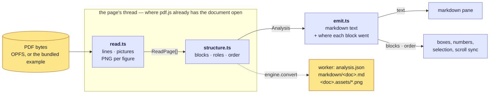
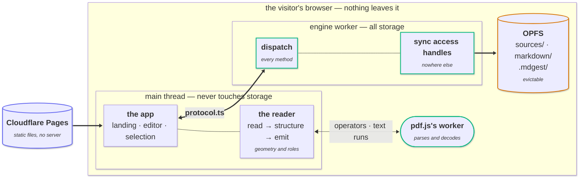

<p align="center">
  
</p>

<p align="center">
  <em>pdf to markdown converter, page by page, your data stays on your machine.</em>
</p>

# mdgest

PDF to Markdown. The one missing feature to [pdf.net](https://pdf.net).

**Why would you need this?** Maybe to use pdf content in LLM prompts or RAG-based pipelines for downstream image and/or text models.

| **Contents**                                                |
| ----------------------------------------------------------- |
| [How it works](#how-it-works)                               |
| [Getting Started](#getting-started)                         |
| [Workspaces and exporting](#workspaces-and-exporting)       |
| [How a page becomes markdown](#how-a-page-becomes-markdown) |
| [Architecture](#architecture)                               |
| [Development](#development)                                 |

---

## How it works

Instead of one function that takes a `.pdf` and returns a `.md`, `mdgest` is an
offline pdf→md tool where a human in the loop can verify the markdown is right,
page by page. Nothing is uploaded anywhere: the conversion runs in your browser,
and the workspace lives in your browser's own storage.

Upload any collection of pdfs:

- a single pdf
- a zip of pdfs
- a folder with pdfs in it

**What every conversion guarantees:**

- all text from the pdf makes it into the markdown
- every picture large enough to be a figure is written beside the markdown and
  linked from it.

Nothing is summarized, rewritten or dropped for being hard to place: a block the
engine cannot make sense of comes out as a paragraph, where you can see it and
fix it.

**Formatting and Edit features:**

- pdf -> md - `pdf.js` reads every line and picture, `structure.ts` determines reading order and formatting, `emit.ts` writes the markdown.
- toggle - click to select, `shift`-click for a range, `ctrl`/`cmd`-click for distinct blocks, click away or `esc` deselects.
- format - toggle blocks and set their formatting from the floating toolbar.
  - heading level (**H1**, `#`), (**H2**, `##`), (**H3**, `###`), (**H4**, `####`)
  - ¶ paragraph (plain text)
  - > Blockquotes
  - lists (unordered: `-`, numbered: `1.`, alpha: `a.`, roman: `i.`)
    - we do not yet support capital alphabetical or roman lists.
    - this could be implemented so when a user hovers over the `a.` or `i.` in the toolbar, a capital `A.` and `I.` show above the respective buttons.
    - this would be similar to the iphone keyboard feature where you press and hold on a key and then special letters come up above it.
  - Indentation (for lists only) - mdgest allows left and right indentation
  - **bold**
  - _italic_
  - insert page break (`---`) before or after selected block
  - hide (writes the block content in a `<!-- markdown comment -->`)
  - delete (omits block content from going into markdown at all)
  - join (two or more consecutive blocks)
  - divide (one block at a time; you decide where to split.)
- edit - raw markdown; free text. _apply_ checks formatting and saves changes. Revert with one undo.
- Undo with `ctrl`+`z`
- Redo with `ctrl`+`shift`+`z` or `ctrl`+`y`
- Revert to original to drop every edit and read the PDF again
- control page numbers and repeated headers and footers: keep them as text (the default), hide them as comments, or delete to keep them out of markdown.
- mark done, which locks a document until it is reopened
- export workspace (includes rules from edits made and pdf sources) or just the markdown as a zip or folder
- a guided tour on a bundled two-page example, so none of this has to be learned on your own document

**Not built yet** — in the order they matter

|                  |                                                                                                        |
| ---------------- | ------------------------------------------------------------------------------------------------------ |
| cross out        | ~~strikethrough~~ option in floating toolbar. Needs to click and drag to highlight text.               |
| task Lists       | Use - [ ] for unchecked boxes and - [x] for checked boxes.                                             |
| mutable indices  | click-and-drag to reorder or click and edit index                                                      |
| tables           | convert to markdown table syntax                                                                       |
| code             | `inline_code()` and ```<language> multi-line code                                                      |
| math             | Needs research. Markdown supports latex. `$...$`                                                       |
| images           | drag corners to resize height / width; choose left, center, right placement; rotate                    |
| mermaid diagrams | https://mermaid.ai/open-source/intro/ for different diagrams. Simple one to start: DAG (detect arrows) |
| `rules.json`     | what the engine learns from a folder's documents (biggest design piece left)                           |

> Note to self: Do we need any tooling for table of contents and configuring those?
> Maybe [^1] for footnotes?

The reader that turns a PDF into blocks is versioned, and every reading
records the version that made it. A reading is kept once made, so a document
read by an earlier version keeps that version's reading after mdgest's reader
improves (_When the reader changes_, below).

Reverting is how a document gets the current one: it is not _back to the
reading first made_, but a new reading by the current reader version. The
button names both versions before it acts:

- **edits to drop**: it asks first, and says which reader version made the
  reading and which one will make the new one
- **no edits, read by an older reader version**: it reads the document again
  without asking, since nothing is lost
- **no edits, read by the current reader version**: it is disabled. A new
  reading would be the same as the one there is

---

## Getting Started

```bash
git clone https://github.com/roest1/mdgest.git && cd mdgest
curl -fsSL https://bun.com/install | bash
bun install
bunx playwright install --with-deps chromium   # once, for bun run test
bun run dev          # http://127.0.0.1:2048, or set WEB_PORT
```

`bun run lint` (oxlint), `bun run typecheck` (`tsc -b`), `bun run test`
(vitest in headless Chromium, _Testing_ below) and `bun run build` (`tsc -b`
then vite) are what CI runs, in that order, after
`bun install --frozen-lockfile`, on every push to `main` and every pull
request.

## Workspaces and exporting

<p align="center">
  
</p>

Browser storage is evictable and there is no account, so **exporting is what
saving means**. A workspace is a tree in your browser's own storage (at
`workspaces/default/`), and an export of it is a folder on your disk that you
hand back later to carry on where you left off. Nothing in it is hidden.
Folders are yours to organize however you like — mdgest mirrors them. Say you
upload `invoice1.pdf` into an `invoices` folder:

    <workspace>/
      mdgest.json                              the manifest: each document's SHA-256 and every decision
      sources/invoices/invoice1.pdf            the source PDF, untouched
      markdown/invoices/invoice1.md            the output, same tree
      markdown/invoices/invoice1.assets/       its figures, as PNGs
      .mdgest/invoices/invoice1.pdf/
        analysis.json                          the engine's read of the PDF (blocks, fonts, roles) — regenerable until it has edits
        edits.json                             your corrections, whether it is done, and its undo history

Every edit is written to `edits.json` as it is made; there is no save button.

### Exporting

**Export**, in the editor's header, writes the workspace out as a zip on any
browser, or straight into a folder you pick on Chromium ones:

    my-project/
      mdgest.json          every document's hash and decisions, in one file
      sources/             the PDFs, exactly as they went in
      markdown/            each document marked done, with its figures

A markdown-only export writes `markdown/` alone. Markdown is written for done
documents only, so nothing half-finished goes out looking finished. Into a
folder, the folder must be empty or one an earlier export wrote; what that
export wrote is replaced, and nothing else there is touched.

`mdgest.json` is the browser's per-document `edits.json` files gathered into
one, without their undo history. Each document's entry carries its source's
SHA-256, the `reader` version its blocks came from, whether it is done, its
edits with the version of their format, and a `check`: the SHA-256 of the
rest of the entry. In a zip the file is marked read-only — a hint most unzip
tools honor, not a lock. What protects it is the check:

- **an entry changed since it was exported** is marked `edited` when the
  project is dropped back in, and continuing asks first. Its edits come in as
  they are now
- **an entry whose edits do not make sense** (a heading level of 9, a role
  that does not exist) costs that one document its decisions, never the whole
  import. It is marked `starts over`, with the reason, and is read from scratch
- **an entry from another reader**, whose block ids would point at different
  blocks, starts over the same way

Continuing unpacks each entry back into that document's `edits.json`.

### Adding, continuing, and replacing

Everything you drop — PDFs, folders, zips — is listed before anything is
written. The list says what the button under it will do to each file, and
nothing reaches the workspace until you press it.

**A project to continue is recognized by one file.** A folder or zip with
`mdgest.json` at its root, or one folder down, is an earlier export, and it continues where it left
off. Anything else is PDFs to add. Loose PDFs join whichever workspace is
there, whether you just dropped it or it's left over from a previous visit.

**One workspace per browser.** A second project is refused until the first is
discarded, so an old export is continued into an empty browser, as a whole.
Documents are never mixed between the two. Discarding the browser's workspace
asks first, because it holds the only copy of anything you haven't exported.

**A document is its path.** `invoices/invoice1` is the id its edits are keyed
to. A file's SHA-256 is evidence about it, never its identity. Each
row in the list gets one of these marks:

| mark        | meaning                                                                                  |
| ----------- | ---------------------------------------------------------------------------------------- |
| _(none)_    | already here, byte for byte, and nothing is written — or, creating a workspace, new      |
| `new`       | not here yet, and added as-is, when continuing a workspace                               |
| `revised`   | here already, with different bytes under the same name. You're asked again before commit |
| `missing`   | listed in the manifest with no PDF. The decisions are kept and wait for the file         |
| `duplicate` | the same bytes as another row, under another name. Both are kept unless you take one out |
| `conflict`  | two different files for one name. Keep one or rename the other before you can continue   |

Dropping a file the workspace already holds, under the same name, adds no
row; the drop just says it was already uploaded.

Matching is exact, with no fuzzy "this looks like the same PDF". The case that
really happens is the same file picked again from the same folder, and exact
equality catches it without false positives. Two PDFs that are only _similar_
have different block layouts, so their edits wouldn't transfer anyway.

**Revised is the one to be careful with: a revised PDF starts over.** A
block's id is its position (`p{page}b{index}`, or `p{page}i{index}` for a
picture), not its content, so edits made
to the old file would resolve against the new one to whatever block now sits
in each position — a heading on a paragraph, a hide on real text. Markdown
that looks done and is wrong is worse than redoing the work. So committing a
revised PDF replaces the old one and drops everything made from it: its
analysis, its markdown and figures, its edits and its done mark. Only one
version of a document is ever kept, and there is no restoring the old edits;
an export made beforehand is the only copy. That is why committing one asks a
second time.

**Before writing**, the list checks there is room: twice the size of what
arrives, because markdown and analysis come out of it later. It also checks
that no other tab has changed the workspace since the list was drawn. If one
has, nothing is written, and you're asked to reload. Committing also asks the
browser to keep the site's storage; that request can be refused.

### Rules: what gets learned

_Designed, not built — the `rules.json` row of the roadmap._

A rule maps how a block looks on the page — font size, weight, indent, marker — to the role you decided it should have. Not the text, the shape: "14pt bold, indent 2 → heading level 2." Text rules are in the design too, for repeated headers and footers, keyed by wording with digits wildcarded so page numbers don't break the match — the per-document detection is already built (_Where fidelity is still missing_, below); what a rule adds is carrying the choice across a folder.

Rules are learned when you mark a document **done**, not on every edit. A heading level you try and undo on page 2 never touches `rules.json` — only your final, confirmed edits do. The one exception is hiding a repeated line at folder scope, which is deliberately explicit and shown across every occurrence before you commit. When rules apply, the deepest matching folder wins, and your own `edits.json` always overrides whatever a rule guesses.

The payoff: the second document in `invoices/` that shares a template edits faster than the first — headings, footers, and boilerplate that formatted the same way get recognized before you touch them. And because a rule is a plain, readable JSON entry with an example block attached, you can see exactly why the engine made a call, and delete or override any single rule without retraining anything.

---

## How a page becomes markdown

Three files, one direction, no model — and `convert.ts` as the conductor: one
reading per document at a time, the engine's cached `analysis.json` used when
there is one, and the result put in the store for both panes.



`read.ts` and `structure.ts` run on the page's thread, because that is where
pdf.js has the document open and where a canvas exists to draw a figure into
(_Where it runs_, below). `emit.ts` is pure and runs on both sides: the worker
calls it to write `markdown/<doc>.md`, and the page calls it to know which
source lines a block became — so the numbered boxes on a page and the numbered
lines beside them are one list by construction, not two lists kept in step.

**Why pdf.js.** It was chosen over pdfium by measurement: over four documents
it reproduced the reference markdown byte for byte, and where the two
disagreed — nine lines — pdfium was wrong every time.

**The frame.** Everything downstream of `read.ts` is in PDF points, in each
page's own frame at scale 1, origin top-left, y down — what
`getViewport({ scale: 1 })` lays out, with the page's rotation already applied.
A box in an analysis is where a person sees the thing, which is what lets the
page pane draw it by multiplying by the zoom and nothing else.

### Reading the page

#### Text

pdf.js hands over runs: a string in one font on one line, or a piece of one. A
run is not a line and not a word, so the line has to be rebuilt.

1. **Boxes.** A run's box is where its ink is, not the font's ascent and
   descent. Those bound every glyph the face has, so they would make each
   line's box reach the next one's and hide the leading between them — the gap
   every step below and all of structure tells lines, paragraphs and bands
   apart by. The characters say most of what the ink would: up to cap
   height (`0.7 ×` the size) when the run has a capital, digit or ascender,
   only to x-height (`0.5 ×`) when it has none, and down to `0.22 ×` below the
   baseline only for a descender. A face of pictures — Wingdings, Webdings,
   Symbol, Dingbats — or a run with nothing to measure by, no capital, digit,
   ascender or x-height letter, is given half its em box, centered.
   These fractions were measured against pdfium's ink boxes, which is what the
   thresholds in structure were first tuned on.
2. **Baselines.** Runs whose vertical middles fall inside one another's span,
   with at least half a run's height in the overlap, share a baseline. That is
   checked both ways round: a superscript sorts first, being higher, and the
   line under it has to be able to join it.
3. **Columns.** Within a band, runs are taken left to right and cut where the
   horizontal gap is wider than `0.6 ×` the taller run's height — except behind
   a list marker, where the gap is allowed to be `3 ×` as wide, because the
   space after a bullet is a wide one and a bullet is not a column of its own.
   A bullet drawn in Wingdings or Webdings comes out of pdf.js as its code in
   whatever form — `§`, `¡`, a control character, a private-use one — so a
   run of one glyph in those faces is read as `•`, as is `U+F0B7`, where Word
   maps the Symbol face's bullet. That is what lets it join its words and be a
   list item.
4. **Spaces.** Between two runs of one line, a gap over `0.15 ×` the height is a
   space; anything smaller is kerning. A space pdf.js put in the string itself
   is kept too: the run's width already covers it, so no gap shows it, and
   `STAR® is` would otherwise come out `STAR®is`.
5. **Style.** A line's weight and slant are its majority _by character_, not
   by run: one italic word does not make an italic line. Its size and font are
   its longest run's. The font is the PDF's own name with the subset prefix
   stripped, so `ABCDEF+Helvetica-Bold` is `Helvetica-Bold`. Weight and slant
   are what pdf.js reports for the font, or else what its name says, spelled
   out or cut short (`-Bd`, `-It`, as in `HelveticaNeueLTW1G-BdIt`).

#### Pictures

A page's operator list is walked with the transform pdf.js's own canvas would
have at each step — `save`/`restore`, `transform`, form XObjects and
transparency groups all tracked — so every painted image is caught with the
matrix it was drawn under. That is what gives a picture its box on the page,
rather than its intrinsic size.

Not every painted image is a figure:

| threshold        | value              | what it excludes                                                            |
| ---------------- | ------------------ | --------------------------------------------------------------------------- |
| `MIN_PICTURE_PT` | 4 pt each way      | hairline rules, bullet glyphs drawn as bitmaps                              |
| `MIN_PICTURE_PX` | 64 px on each side | bullets drawn as small bitmaps, stretched strips of one-pixel gradient…     |
| `BIG_ENOUGH_PT`  | 24 pt each way     | …unless drawn this large, where a few pixels blown up really is the picture |

What survives is drawn through its own transform into a canvas, so a rotated or
mirrored picture comes out the way it is seen, and written as a PNG at least
`2` pixels per point and at most `4096` per side. A picture that cannot be
decoded falls back to rendering the page region under its box. Every surviving
picture is written and has a line in the markdown — there is no such thing as a
figure in the analysis that is not in the output.

Pictures are read before text on purpose: walking the operator list is what
loads the page's fonts, which the text's styles are then read from.

**Annotation appearances are disabled** at read time
(`AnnotationMode.DISABLE`), which keeps form widgets and stamps out of the
geometry. Link annotations are read separately (`getAnnotations`): a line at
least half under one carries its URL, a block whose lines all point one way carries it
too, and the markdown writes that block as `[text](url)`. A link on part of a
paragraph keeps only its words — a line is the finest grain a link is tied to.

### Structure: blocks, roles, order

Pure functions over what `read.ts` produced. The structure is read off the page
the way a person reads it in a second: what is larger or bolder is a heading,
what sits behind a bullet is an item, what sits further right is nested deeper,
what shares a column is read down before across.

**The body size** is the size most _characters_ are set in, to a tenth of a
point — characters, not lines, so a document with fifty short headings and ten
long paragraphs still has the paragraph's size as its body.

**Whether bold means anything** is decided document-wide before anything else:
if more than 35% of the text is bold, bold is the body face and stops being
evidence of a heading. Under that, a bold line at body size or larger that does
not end in `.`, `,` or `;` reads as a heading, as does any line at `1.1 ×` body
or larger. A line over 90 characters is prose however it is set, and a line that
starts with a list marker is an item.

**Reading order is an XY-cut.** Recursively: cut on vertical gutters first, then
on horizontal bands, until neither exists. Columns win over bands, because two
paragraph breaks that happen to line up across two columns are not a reason to
read across. A gutter has to be at least `0.6 ×` the page's median line height
and at least 3 points.

**Lines become blocks** by walking that order and asking whether each line
continues the one before it: close enough vertically (within `1.1 ×` line
height), overlapping horizontally, the same size and weight, and not starting
with a list marker. A wrapped paragraph may hang-indent, so a continuation is
allowed to start right of the first line's left edge but not meaningfully left
of it. A list item's own continuation lines may start anywhere under it. Two
heading lines in a row wrap into one heading.

**List markers** are matched off the front of a block's first line —
`•`-family glyphs, `-`/`–`/`—`/`·`/`*` followed by a space, `1.`, `(a)`, `iv)` —
and the marker is taken off the text and kept in `marker`. The dash and star
forms need the space: `-5 °C` and `*emphasis*` start lines too.

**Depth** comes from indentation, clustered within a column: the distinct left
edges of that column's list items, anything within 3 points folded together, and
an item's depth is how many of them sit to its left. A plain line indented under
an item, in the same column, no bolder and no larger and close below, is that
item's detail and becomes a nested bullet.

**Heading levels** are assigned document-wide from size alone: larger type is a
higher level, a size within 8% of the largest size in a level joins that level
(a 24pt and a 25pt title are the same thing), and nothing goes deeper than
`####` by default.

**Pictures are placed** among the text rather than appended: before the text
nearest to it — its label to the right on the same row, or its caption below it
— and at the end of the page when there is neither.

### Emitting

One pass per page, in block order:

- a heading is `#` × its level, with a blank line either side
- a list item is indented to where its parent item's text starts — two spaces
  under `- `, three under `1. ` — then its marker. Ordered markers are
  **counted, not copied**, and always decimal: CommonMark has no lettered or
  numeral lists, so `a.` and `iii.` are written as numbers, and the pane letters
  and numerals the levels back. A paragraph resets the count, coming back up a
  level resets the deeper ones, and each page counts from `1.` — a list carried
  onto the next page restarts there
- a picture is ``
- bold and italic are applied to the whole block when every line of it carried
  them, and never to a heading
- characters that would read as markup — `*`, `_`, `` ` ``, `[`, `<`, `&`, `~`,
  `\`, and a `#`, `>`, `+`, `-` or `1.` opening the line — are escaped, so the
  pane shows what was printed
- `---` between pages

What comes back is not only text. `Markdown` also carries, per block, the page
it was on, its number on that page, and the source line range it became — plus
`order`, every block written in document order. The editor's selection, the
line highlighted in the raw view, the range a `shift`-click covers, and scroll
sync all key off this.

### Where fidelity is still missing

Everything above is a _default_, and every default is a guess a person should be
able to overrule. That is `edits.json`: the analysis is regenerable from the
PDF — and kept once made — and the markdown regenerates from the analysis and
the edits. The roadmap under _How it works_ lists features to build; this is
what the reader gets wrong today, and what fixing it would take.

**Page furniture** is the clearest case. `furniture.ts` finds what a page prints
in its margin bands that is not the document — a page number, or a wording
repeated there on two pages or more and mostly in a margin wherever it appears,
digits wildcarded so `Page 3 of 40` matches its own kind — and each kind is a
setting per document: kept as text (the default), hidden as a comment, or
deleted. Position decides before wording, and the setting is applied where the
markdown is written, so no block moves and the reader is untouched.

Beyond that, what a conversion cannot yet get right — a gap with a test case
named beside it is drawn as an expected failure in the suite (_Testing_,
below):

| gap                                                                      | what comes out today                                                                                                            | what it would take                                                                                                                                              |
| ------------------------------------------------------------------------ | ------------------------------------------------------------------------------------------------------------------------------- | --------------------------------------------------------------------------------------------------------------------------------------------------------------- |
| **tables**                                                               | the cells as separate blocks, in XY-cut order — usually one paragraph per cell                                                  | a ruling/alignment pass over a band: detect the grid from line boxes and drawn rules, then emit a GFM table. `remark-gfm` already renders them                  |
| **math**                                                                 | the glyphs as printed, so a fraction comes out as its numerator and denominator on two lines                                    | recognizing math runs by font (the `CM`/`STIX`/`MS` families) and layout, then emitting `$…$`. This is the hardest one                                          |
| **hyphenation**                                                          | a word broken across two lines stays broken                                                                                     | joining `-` at a line end when the next line continues lowercase — safe in prose, wrong in code and in compound terms, so it wants to be an edit, not a default |
| **rotate**                                                               | the page's own rotation is applied; a block cannot be turned                                                                    | a per-block override in the edits, and a reading pass over sideways text                                                                                        |
| **reading order across pages**                                           | each page is cut on its own, so a paragraph spanning a page break is two blocks until a person joins them                       | a rule for continuation                                                                                                                                         |
| **columns under a full-width line** (`blocks-two-columns-under-a-title`) | two columns between a title and a footer that span the gutter are read across, row by row, where their paragraph breaks line up | cutting on the gutter where it runs, not only where it crosses the whole region                                                                                 |
| **first-line indents** (`blocks-first-line-indent`)                      | paragraphs told apart only by an indented first line, as books and papers set them, run together                                | reading an indented line after a full-width one as a new paragraph                                                                                              |
| **long lettered lists** (`lists-lettered-past-h`)                        | `i.` after `h.` is read as the numeral one, and the count restarts there                                                        | judging an ambiguous marker by the items around it                                                                                                              |
| **ZapfDingbats bullets** (`lists-dingbat-bullets`)                       | a bullet in that face comes through pdf.js as a letter (`l` for ●) and stands apart from its item                               | remapping that face's codes the way Wingdings' are                                                                                                              |

Each of these is a fidelity feature, not a rewrite: they add roles and
attributes to `Block`, and lines to `emit.ts`. The frame, the ids and the cache
do not move.

### When the reader changes

The same failure as a revised PDF (_Adding, continuing, and replacing_,
above), from the other side: the bytes stay the same, and `read.ts` or
`structure.ts` changes which blocks they become — so edits, keyed to
positions, would land on the wrong ones.

`READER` in `analysis.ts` is a number bumped by hand whenever a change to the
reader could move, merge or split a block, and every analysis records the one
that made it. In the browser, a document's analysis is read once and kept, so
its edits always apply to the blocks they were made on. An export writes that
analysis's `reader` into the entry of each document that has edits — not this
build's, since a kept analysis can be older — and an import from a different
reader starts that document over, as a revised source does. The analysis
itself is not exported: with the same reader, reading the PDF again makes the
same blocks, and its figures with them.

**pdf.js is part of the reader.** It is not pinned, and an upgrade can change
the text runs `read.ts` is given as surely as a change to `read.ts` can.
`READ_WITH`, beside `READER`, is the pdf.js version the reader was made with,
and a test in `tests/reader.test.ts` fails when the installed one differs. The
fix is to bump `READER` and move `READ_WITH` up together, without checking
whether any block moved: nothing here can say so for embedded fonts or odd
encodings, which the drawn test cases (_Testing_, below) do not use. A
needless bump costs only an older export's edits on import. Once others have
exports, pin pdf.js and upgrade it on purpose rather than take every release
as a bump.

---

## Architecture

### Tech stack

**the app** — one bundle, hosted as static files on Cloudflare Pages. No server,
no account, and no request to any other origin: what it fetches after the page
loads — the editor, pdf.js's worker and data, the tour — is its own.

|          |                                                                                                                    |
| -------- | ------------------------------------------------------------------------------------------------------------------ |
| build    | `vite` 8 (rolldown), `typescript` 7, `oxlint`                                                                      |
| ui       | `react` 19, `react-router` 8, `tailwind` 4, `lucide-react` icons                                                   |
| state    | `zustand` — one store for what both editor panes read                                                              |
| pdf      | `pdfjs-dist` 6 — its assets shipped same-origin (_What the boundaries are_, below)                                 |
| markdown | `react-markdown` + `remark-gfm` for the rendered view                                                              |
| archives | `fflate` — unzip on the way in, zip on the way out                                                                 |
| fonts    | Literata (serif), Geist Sans (ui), JetBrains Mono (code), Caveat (the tour's hand) — self-hosted via `@fontsource` |

**pdf.js reads the PDF.** Every line with its box, size and weight, and every
picture with the bounds it was drawn to. It was chosen over pdfium by
measurement, not preference (_How a page becomes markdown_, above).

**OPFS is the workspace.** The origin-private file system is the only storage
every browser has, and its synchronous access handle reads or writes a whole
file in one call (_Where it runs_, below).

### Where it runs

Where everything goes once the bundle reaches a browser. Every boundary the app
has is inside one tab.



The build that puts those files on the edge is a gate, not a deploy: the checks
under _Getting Started_ run on every push to `main` and every pull request, and
stop there. Cloudflare Pages is expected to build the same way from the repo,
with `bun run build` as the command and `dist` as the output directory; that
connection is configured on the Cloudflare side and is not in this repo.

#### What the boundaries are

**Edge to browser.** `dist/` is plain files, two of them hosting
configuration. `_redirects` answers a deep link like `/edit/manuals/valves`
with `index.html` and a 200 rather than a 404, which the router needs;
`_headers` carries the CSP. Nothing enforces either in dev or preview — the
dev server handles deep links on its own — so breaking one shows up only once
deployed (_What to check after changing the CSP_, below).

**Main thread to engine worker.** OPFS's synchronous access handle is not
exposed on the main thread, so everything that touches storage runs in
`engine.worker.ts`, and `protocol.ts` is the contract: a map of method to
`{params, result}` that both sides are typechecked against. Adding a method
without a handler fails `tsc -b`, and therefore fails the gate. Large payloads
cross by transfer, not copy — a document's bytes, a figure's, and an export's
zip — so a hundred-megabyte PDF is never held twice. `engine.ts` starts the
worker lazily, on the first call rather than on load — the landing's
`stageView()` is usually it — waits for the `READY` the worker sends once it has
made `sources/`, `markdown/` and `.mdgest/`, and sequences every call after
that by id against a pending map.

**Main thread to pdf.js worker.** The second boundary, and pdf.js's code on the
other side of it: `pdf.ts` starts pdf.js's worker on the first document opened,
as a module worker from a same-origin file, and pdf.js parses and decodes
there. That is why reading a document runs on the page's thread rather than in
the engine worker (_How a page becomes markdown_, above). `read.ts` does
geometry on what comes back; the engine worker never sees a PDF as anything
but bytes.

**The pdf.js assets** — character maps, the standard fourteen fonts, and the
no-wasm fallback decoders — are files pdf.js fetches on demand rather than code
it bundles. A plugin in `vite.config.ts` copies them out of the package into
`dist/pdfjs/` and serves them in dev from memory, so there is one list of them
and it is not a `public/` copy anyone has to remember to refresh.

**Worker to OPFS.** Resolving a handle is async everywhere; only read and write
on an already-resolved sync handle are synchronous. Every write truncates first,
because a sync handle writes at an offset into whatever is already there, and
every handle is closed in a `finally`, because an open one holds an exclusive
lock that the next open would reject on. Web Locks keep two tabs from writing
one workspace at once: a commit takes that lock and writes the manifest, then
each row's source, then the manifest again. The first write carries every
decision but leaves out the hash of each source it is about to write, and a
document with no hash is one whose bytes are hashed on the next look — so a
commit that stops partway, on a full disk or a file since moved, leaves a
manifest wrong about nothing. The second adds the hashes once the bytes are
down.

**OPFS to disk.** `persist` asks the browser not to evict, and a `true` there
is advisory — which is why an export, not the workspace, is the durable copy
(_Workspaces and exporting_, above). Export writes a zip or a folder, and
dropping an export back in continues from it.

#### Browser floor

| Requirement                      | Chrome / Edge | Firefox | Safari   |
| -------------------------------- | ------------- | ------- | -------- |
| OPFS with sync access handle     | **102**       | 111     | 15.2     |
| module worker (`type: "module"`) | 80            | **114** | 15       |
| Web Locks (`navigator.locks`)    | 69            | 96      | **15.4** |

The floor is the highest number in each column: the sync access handle sets
Chrome's (`getDirectory` alone is 86, the handle is not), the module worker
sets Firefox's, and Web Locks set Safari's. Dropping to a classic worker would
need a bundled script and would lower Firefox to 111.

These are the APIs the workspace is built on. `pdfjs-dist` 6 declares no
browser floor of its own — only a Node one, for its build — so this table is
the app's, and it is worth re-measuring on a browser near the bottom of it
rather than trusting that the reader comes along for free. `OffscreenCanvas` is
not used: figures are drawn on the main thread, into an ordinary canvas.

---

## Development

### Testing

```sh
bun run test          # everything, once, in headless Chromium
bun run test:watch    # re-run on save
bun run fixtures      # write every reader case to tests/out/ as a PDF
```

The tests run in a real browser because the reader needs one: `read.ts` draws
figures into a canvas, pdf.js parses in a worker, and OPFS's file handles exist
only in a worker. Playwright's Chromium does the running; on a fresh machine or
in CI, `bunx playwright install --with-deps chromium` first. Nothing under
`tests/` is imported from `src/`, so none of it reaches a build.

#### What is tested

What this code decides, not what the language or the browser guarantees.

**The reader.** `tests/reader.test.ts` runs every case through the app's own
path — pdf.js opens the fixture, `readPage` reads each page, `structure` makes
the blocks, `emit` writes the markdown — and asserts that the installed pdf.js
is the version `READER` was made with (_When the reader changes_, above).

The reader is almost all decisions — every threshold in _How a page becomes
markdown_ is a guess about how a page is read — so most cases sit a known
distance either side of one. The cases live in `tests/cases/`, one file per
area its name says: headings, lists, blocks, style, links, pictures, pages.

**Editing.** Every edit is a decision about what a person meant.
`tests/edits.test.ts` covers hide, delete, and the numbering blocks keep or
give up; `tests/source.test.ts`, one line of raw markdown read back onto its
block; `tests/draft.test.ts`, a whole-markdown draft paired with blocks by
their words rather than their place; `tests/divide.test.ts`, cuts, the pieces
they make, and join putting a divided block back; `tests/furniture.test.ts`,
the page-number and header/footer settings and their undo. What each file
asserts in full is its own `it` names.

**The workspace.** `tests/opfs.test.ts` covers the file layer — truncating
writes, `walk`'s order, `sha256`, what `removeDerived` may touch;
`tests/stage.test.ts`, staging a dropped folder; `tests/assets.test.ts`,
figure handles let go on replace and remove; `tests/store.test.ts`, the store
under a document named `__proto__`; `tests/words.test.ts`, the counting the
UI phrases with.

**The fixtures under them.** `tests/fixtures/pdf.ts` is the pen: pages drawn
at exact positions, sizes and faces. `tests/cases/index.ts` registers every
case file — a new default gets a file and an entry there. `tests/cases/case.ts`
holds the `Case` type and `summarize`, `tests/cases/text.ts` the shared prose
and leading (each line with a capital and a descender, so every ink box is the
same height), and `tests/fixtures/write.ts` writes a case out for
`bun run fixtures`. `tests/opfs.worker.ts` and `tests/stage.worker.ts` run
`opfs.ts` and `stage.ts` where they run in the app, since a synchronous file
handle exists only in a worker.

#### Adding a reader case

A case is pages drawn with exact positions, sizes and faces
(`tests/fixtures/pdf.ts`), and what they should read as — the blocks in brief,
and optionally the whole markdown. Document-wide decisions — the body size,
whether bold means anything, heading levels — are made over the whole PDF,
which is why each case is its own file rather than one page of a single test
document.

```ts
{
  name: "lists-indent-tolerance",
  about: "Indents within 3pt are one level (72 and 75); 4pt further in is a level deeper (76).",
  pages: [(pen) => [X, X + 3, X, X + 4].forEach((x, i) => pen.text(x, TOP + i * LEADING, `• ${ITEMS[i]}`))],
  blocks: [`bullet • ${ITEMS[0]}`, `bullet • ${ITEMS[1]}`, `bullet • ${ITEMS[2]}`, `  bullet • ${ITEMS[3]}`],
}
```

Write the expectation from what a person reading the page would say, not from
what the reader prints today. Where the two differ, set `known` to why: the
test is then marked as an expected failure, the suite stays green, and when the
reader is fixed the test fails until `known` is removed. The known gaps today
are the rows of _Where fidelity is still missing_ with a case name beside them.

### What to check after changing the CSP

`_headers` is enforced only on the deployed site, so the check is: deploy,
open a document, and read the console for "Refused to …". The two things most
likely to trip it are figures and the worker. Figures are shown from
`URL.createObjectURL`, which is a `blob:` URL, so `img-src` has to allow
`blob:`; the engine worker is a same-origin file rather than a blob, so
`worker-src 'self'` is enough. Neither is a reason to relax `object-src`,
`frame-src` or `base-uri`, which stay at `'none'` so that a PDF reaching an
`<embed>` fails loudly rather than quietly.

### The mark

`mark.svg` is the source of truth. Everything downstream of it — the PNGs, the
`.ico`, the `.icns` in `docs/brand/icons/`, and the SVGs the app serves from
`public/` — is rendered from it by `scripts/make_brand.py`. Never drawn by
hand, never edited downstream.

```sh
uv run scripts/make_brand.py          # PEP 723: cairosvg and pillow come with it
```

The script needs no project and no virtualenv of its own; its dependencies are
declared in its header and `uv` resolves them per run. Nothing in the web build
depends on it.

#### The four drawings

| File              | What it is                | Where it goes                        |
| ----------------- | ------------------------- | ------------------------------------ |
| `mark.svg`        | the full mark, `pdf → md` | every slot at 24px and up; `public/` |
| `mark-small.svg`  | the arrow alone           | 16px slots only; the favicon         |
| `mark-macos.svg`  | the full mark, inset      | `icon.icns`, all sizes               |
| `lockup-wide.svg` | mark + wordmark on paper  | the top of this README               |

`WEB_SVGS` in the script is the list of what the app serves: add a stem there
and it ships, and there is no second place to update. The rendered set lands in
`docs/brand/icons/`, beside the SVGs it comes from.

#### Why small slots get the arrow alone

Three elements do not survive 16 pixels. At that size a person is not reading the
mark, they are matching a red square in a list — so the small slots get the arrow,
which is a crop of the full mark rather than a different idea. The threshold is the
size a person _sees_, not the pixel count: `icon.icns` holds two different 32×32
images, because one of them is displayed at 16pt on a retina screen.

#### Why macOS gets its own drawing

Apple's icon grid expects app art to sit inside its canvas — roughly 824 of 1024,
with transparent margin. A full-bleed tile renders visibly larger than every native
neighbor in the Dock. `mark-macos.svg` is the same drawing at that inset.

#### Specification

```
gradient      #F0522A → #B01221 at 135°, 17.8° of hue travel
reads as      #D03225 at 16px (a gradient collapses to its average)
letters       #FFF4EE, 4.66 : 1 against that average
tile          64 units, corner radius 14 (21.9%)
safe area     46 × 50
type          Nunito 900, lowercase, tracking −0.015em
layout        arrow rule — type at 19.01/64, clearance 0.16em, arrow shaft 0.21em
wordmark      Literata 600 at opsz 12 (the text cut), tracking −0.028em
lockup        502 × 144 on paper, radius 20 — the mark 104 tall, 52 of side
              padding, 20 above and below. The mark, not the wordmark, sets
              the height: its descender stops 14 short of the mark's foot
```

Both faces are OFL. **Neither is a dependency of these assets** — every glyph
is already converted to outlines, so nothing downstream loads a font (the app's
own UI fonts arrive separately, via `@fontsource`). That is deliberate:
favicons render outside normal font loading, GitHub blocks external resources
inside README SVGs, and the PNGs are rasterised at build time. A `font-family`
reference in any of those falls back silently to whatever the machine happens
to have.

To change the type you need the fonts again — pin `Nunito[wght].ttf` at 900 and
`Literata[opsz,wght].ttf` at 600/12, and re-outline. Do not pin Literata's
`opsz` to 72; that is the display cut, and it has hairline serifs that fight
the mark.
