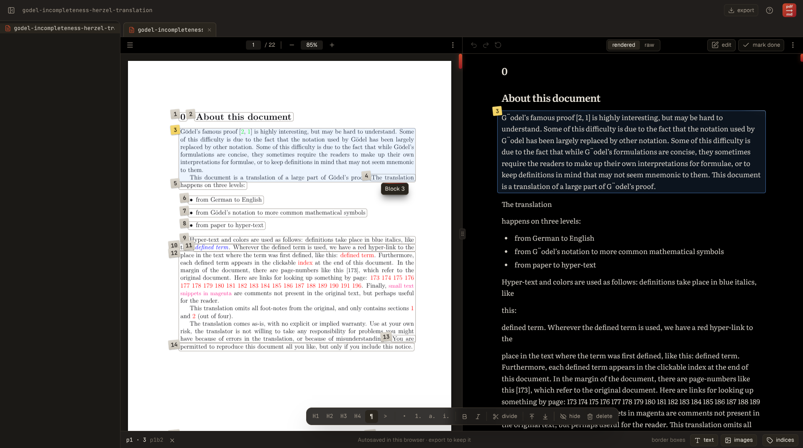
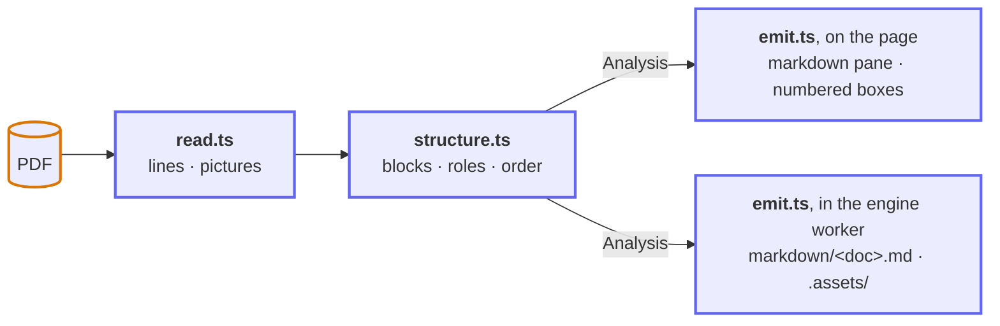
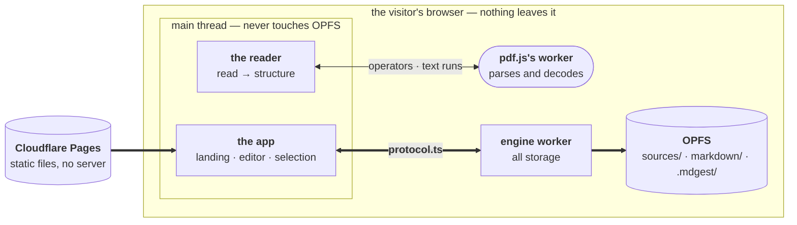

<p align="center">
  
</p>

<p align="center">
  <em>pdf to markdown converter, page by page, your data stays on your machine.</em>
</p>

# mdgest

Instead of one function that takes a `.pdf` and returns a `.md`, mdgest is an
offline pdf→md editor with a human in the loop: it reads every page in your
browser, shows each block it found beside the markdown it wrote, and lets you
fix the ones it got wrong. Nothing is uploaded anywhere — the conversion runs
in your browser, and the workspace lives in the browser's own storage. Drop in
a single pdf, a zip of pdfs, or a folder with pdfs in it.

[Try it!](https://mdgest.dev)

<p align="center">
  
</p>

**What every conversion guarantees:**

- all text from the pdf makes it into the markdown
- every picture large enough to be a figure is written beside the markdown and
  linked from it.

Nothing is summarized, rewritten or dropped for being hard to place: a block the
engine cannot make sense of comes out as a paragraph, where you can see it and
fix it.

**Why would you need this?** To use pdf content in LLM prompts or RAG pipelines
for downstream text and image models — without a conversion you can't inspect,
and without handing your documents to someone else's server.

---

## Development

```bash
git clone https://github.com/roest1/mdgest.git && cd mdgest
curl -fsSL https://bun.com/install | bash
bun install
bunx playwright install --with-deps chromium   # once, for bun run test
bun run dev          # http://127.0.0.1:2048, or set WEB_PORT
```

`bun run lint` (oxlint), `bun run typecheck` (`tsc -b`), `bun run test`
(vitest in headless Chromium — coverage and how to add a reader case:
[tests/README.md](tests/README.md)) and `bun run build` (`tsc -b`
then vite) are what CI runs, in that order, after
`bun install --frozen-lockfile`, on every push to `main` and every pull
request.

### Tech stack

**the app** — one bundle, hosted as static files on Cloudflare Pages. No server,
no account, and no request to any other origin: what it fetches after the page
loads — the editor, pdf.js's worker and data, the tour — is its own.

|          |                                                                                                                    |
| -------- | ------------------------------------------------------------------------------------------------------------------ |
| build    | `vite` (rolldown), `typescript`, `oxlint`                                                                          |
| ui       | `react`, `react-router`, `tailwind`, `lucide-react` icons                                                          |
| state    | `zustand` — one store for what both editor panes read                                                              |
| pdf      | `pdfjs-dist` 6 — its assets shipped same-origin (_What the boundaries are_, below)                                 |
| markdown | `react-markdown` + `remark-gfm` for the rendered view                                                              |
| archives | `fflate` — unzip on the way in, zip on the way out                                                                 |
| fonts    | Literata (serif), Geist Sans (ui), JetBrains Mono (code), Caveat (the tour's hand) — self-hosted via `@fontsource` |

---

## How it works

<p align="center">
  
</p>

Browser storage is evictable and there is no account, so **exporting is what
saving means**: an export is a plain folder or zip on your disk, and dropping
it back in carries on where you left off. Nothing in it is hidden, and folders
are yours to organize however you like — mdgest mirrors them. A name is kept
as it is unless a character in it would not survive a file system, or a
folder would share a name with a document (`workspace.ts`); a single document
or zip over 512 MiB is refused (`limits.ts`). Every file named in this README
is under `src/lib/` unless its path says otherwise.

Everything you drop — PDFs, folders, zips — is listed on the landing before
anything is written, and each row says what opening will do to it: an earlier
export (recognized by its `mdgest.json`, the manifest) continues where it left
off, new PDFs join the one workspace this browser keeps, and a revised PDF, or
one whose edits came from another version of the reader, starts over, because
edits are keyed to block positions. A browser holds one workspace at a time:
a second export is refused until the first is discarded. The marks a row can
carry are `protocol.ts`'s `Status`; what opening does with each one,
`stage.ts`.

Say you upload an `invoices` folder with `invoice1.pdf` inside it. An export
of the workspace is:

    <export>/
      mdgest.json                              the manifest: each document's SHA-256 and every decision
      sources/invoices/invoice1.pdf            the source PDF, untouched
      markdown/invoices/invoice1.md            the output, same tree
      markdown/invoices/invoice1.assets/       its figures, as PNGs

Markdown goes out for done documents only, so nothing half-finished looks
finished; a markdown-only export writes `markdown/` alone. Into a folder, the
folder must be empty or one an earlier export wrote; what that export wrote
is replaced, and nothing else there is touched. `exchange.ts`
documents the manifest's format and what an import does with a changed,
damaged, or other-reader entry.

In the browser the same tree also carries `.mdgest/`, the cache of the engine
(the worker that owns storage): its read of each PDF (`analysis.json`,
regenerable from the PDF) and your corrections, whether the document is done,
and its undo history (`edits.json`, written as each edit is made — there is
no save button). `workspace.ts` has the layout.

Markdown conversion is three files, one direction, no model; `convert.ts`
sequences them, one document at a time.



`emit.ts` is pure and runs on both sides: the engine worker calls it to write
`markdown/<doc>.md`, and the page calls it to know which source lines a block
became — so the numbered boxes on a page and the numbered lines beside them
are one list by construction.

The decisions themselves — how runs become lines, lines become blocks, blocks
get roles and an order, and what each one is written as — are documented where
they are made: the constants and comments of `read.ts`, `structure.ts` and
`emit.ts`, and the coordinate frame they share in `analysis.ts`.

### Where it runs

Where everything goes once the bundle reaches a browser. Every boundary the app
has is inside one tab; what each one is made of — the protocol, the pdf.js
assets, the write discipline — is under _Architecture_, below.



---

## Architecture

The deployed shape: what sits on which side of each boundary, and what a
browser needs to run it.

### What the boundaries are

**Edge to browser.** CI is a gate, not a deploy: the checks under
_Development_ run and stop there, and Cloudflare Pages builds the same way
from the repo (`bun run build`, output `dist`), a connection configured on
the Cloudflare side and not in this repo. `dist/` is plain files, two of them
configuration: `public/_redirects` is the router's deep-link fallback and
`public/_headers` the CSP. Each documents itself, and neither is enforced in
dev or preview, so after changing one: deploy, open a document, and read the
console for "Refused to …".

**Main thread to engine worker.** OPFS's synchronous access handle is not
exposed on the main thread, so everything that touches storage runs in
`engine.worker.ts`, and `protocol.ts` is the contract: a map of method to
`{params, result}` that both sides are typechecked against. Adding a method
without a handler fails `tsc -b`, and therefore fails the gate. Large payloads
cross by transfer, not copy (declared beside each handler in
`engine.worker.ts`), so a hundred-megabyte PDF is never held twice. How the
worker is started and calls are sequenced is in `engine.ts`.

**Main thread to pdf.js worker.** The second boundary, and pdf.js's code on the
other side of it: `pdf.ts` starts pdf.js's worker on the first document opened,
as a module worker from a same-origin file, and pdf.js parses and decodes
there. That is why reading a document runs on the page's thread rather than in
the engine worker. `read.ts` does geometry on what comes back; the engine
worker never sees a PDF as anything but bytes. The data files pdf.js fetches
on demand ship same-origin from `dist/pdfjs/`; `vite.config.ts` says which
and why.

**Worker to OPFS.** Web Locks keep two tabs from writing one workspace at
once, and opening a workspace writes the manifest in two phases, so one that
stops partway leaves a manifest wrong about nothing. The handle discipline and
the manifest phases are documented where they happen, in `opfs.ts` and
`stage.ts`.

**OPFS to disk.** `persist` asks the browser not to evict, and a `true` there
is advisory — which is why an export, not the workspace, is the durable copy
(_How it works_, above).

### Browser floor

| Requirement                      | Chrome / Edge | Firefox | Safari   |
| -------------------------------- | ------------- | ------- | -------- |
| OPFS with sync access handle     | **102**       | 111     | 15.2     |
| module worker (`type: "module"`) | 80            | **114** | 15       |
| Web Locks (`navigator.locks`)    | 69            | 96      | **15.4** |

The floor is the bold number in each column (`getDirectory` alone is Chrome
86; the handle is not). Dropping to a classic worker would need a bundled
script and would lower Firefox only to 111.

`pdfjs-dist` 6 declares no browser floor of its own — only a Node one, for its
build — so this table is the app's, worth re-measuring on a browser near its
bottom. `OffscreenCanvas` adds no row: figures are drawn on the main thread,
into an ordinary canvas.

---

## Features

- pdf → md - the conversion itself (_How it works_, above)
- hyperlinks - links in the PDF survive into the markdown as `[text](url)`
  - no ability to create links yet. For example, link in-text citation to citation link in works-cited which links to a url.
- toggle - click to select, `shift`-click for a range, `ctrl`/`cmd`-click for distinct blocks, click away or `esc` deselects.
- format - toggle blocks and set their formatting from the floating toolbar.
  - heading level (**H1**, `#`), (**H2**, `##`), (**H3**, `###`), (**H4**, `####`)
  - ¶ paragraph (plain text)
  - > blockquote
  - lists (unordered: `-`, numbered: `1.`, alpha: `a.`, roman: `i.`)
  - indentation (lists only), left and right
  - **bold**
  - _italic_
  - insert page break (`---`) before or after selected block
  - hide (writes the block content in a `<!-- markdown comment -->`)
  - delete (omits block content from going into markdown at all)
  - join (two or more consecutive blocks)
  - divide (one block at a time; you decide where to split)
- edit - raw markdown; free text. _apply_ checks formatting and saves changes. Revert with one undo.
- undo with `ctrl`+`z`
- redo with `ctrl`+`shift`+`z` or `ctrl`+`y`
- revert to original to drop every edit and read the PDF again
- control page numbers and repeated headers and footers: keep them as text (the default), hide them as comments, or delete to keep them out of markdown.
- mark done, which locks a document until it is reopened
- export the workspace (every pdf and edit, done or not) or just the markdown, as a zip or folder
- a guided tour on a bundled two-page example, so none of this has to be learned on your own document

---

MIT — see [LICENSE](LICENSE).
