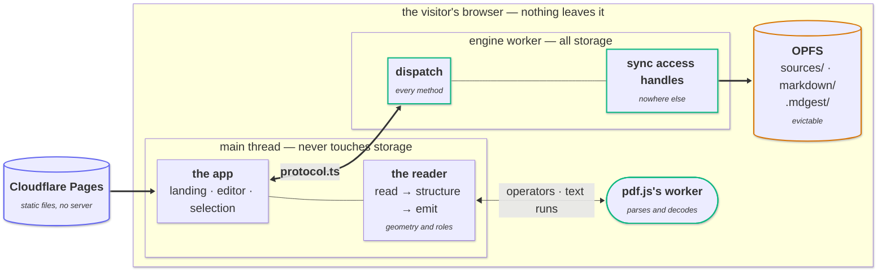

# Deployment

How the app gets from a commit to a visitor's browser, and where everything
runs once it is there. There is no server: the build is static files, and every
boundary the app has is inside one tab.

The build that puts those files on the edge is a gate, not a deploy, and it is
the one part of this with no diagram: `bun install --frozen-lockfile`, oxlint,
`tsc -b`, vitest in headless Chromium, `bun run build`, in that order, on every
push to `main` and every pull request ([testing.md](testing.md)). It stops
there. Cloudflare Pages is expected to build the same way from the repo, with
`bun run build` as the command and `dist` as the output directory; that
connection is configured on the Cloudflare side and is not in this repo.

## What the boundaries are

**Edge to browser.** `dist/` is plain files. Two of them are hosting
configuration. `_redirects` answers a deep link like `/edit/manuals/valves`
with `index.html` and a 200 rather than a 404, which the router needs and the
dev server does on its own — so deleting it breaks nothing until it is
deployed. `_headers` carries the CSP, and nothing honors it in dev or preview
either, for the same reason and with the same trap; the file documents itself.

**Main thread to engine worker.** OPFS's synchronous access handle is not
exposed on the main thread, so everything that touches storage runs in
`engine.worker.ts`, and `protocol.ts` is the contract: a map of method to
`{params, result}` that both sides are typechecked against. Adding a method
without a handler fails `tsc -b`, and therefore fails the gate. Large payloads
cross by transfer, not copy — a document's bytes, a figure's, and an export's
zip — so a hundred-megabyte PDF is never held twice. `engine.ts` starts the
worker lazily, on the first call rather than on load — the landing's
`stageView()` is usually it — waits for the `READY` the worker sends once it has
made `sources/`, `markdown/` and `.mdgest/`, and sequences every call after
that by id against a pending map.

**Main thread to pdf.js worker.** The second boundary, and pdf.js's code on the
other side of it: `pdf.ts` starts pdf.js's worker on the first document opened,
as a module worker from a same-origin file, and pdf.js parses and decodes
there. That is why reading a document runs
on the page's thread rather than in the engine worker — pdf.js has the document
open there, a canvas exists there to draw a figure into, and the expensive part
is already off-thread. `read.ts` does geometry on what comes back; the engine
worker never sees a PDF as anything but bytes.

**The pdf.js assets** — character maps, the standard fourteen fonts, and the
no-wasm fallback decoders — are files pdf.js fetches on demand rather than code
it bundles. A plugin in `vite.config.ts` copies them out of the package into
`dist/pdfjs/` and serves them in dev from memory, so there is one list of them
and it is not a `public/` copy anyone has to remember to refresh.

**Worker to OPFS.** Resolving a handle is async everywhere; only read and write
on an already-resolved sync handle are synchronous. Every write truncates first,
because a sync handle writes at an offset into whatever is already there, and
every handle is closed in a `finally`, because an open one holds an exclusive
lock that the next open would reject on. Web Locks keep two tabs from writing
one workspace at once: a commit takes that lock and writes the manifest, then
each row's source, then the manifest again. The first write carries every
decision but leaves out the hash of each source it is about to write, and a
document with no hash is one whose bytes are hashed on the next look — so a
commit that stops partway, on a full disk or a file since moved, leaves a
manifest wrong about nothing. The second adds the hashes once the bytes are
down.

**OPFS to disk.** Browser storage is evictable and there is no account, so an
export is what saving means. `persist` asks the browser not to evict, and a
`true` there is advisory. Export writes a zip or a folder (README,
*Exporting*), and dropping an export back in continues from it.

`emit.ts` runs on both sides of the engine-worker boundary and is pure, which
is the point: the file in the workspace and the text on screen come from one
function over one analysis, so they cannot drift.

## Browser floor

| Requirement                      | Chrome / Edge | Firefox | Safari   |
| -------------------------------- | ------------- | ------- | -------- |
| OPFS with sync access handle     | **102**       | 111     | 15.2     |
| module worker (`type: "module"`) | 80            | **114** | 15       |
| Web Locks (`navigator.locks`)    | 69            | 96      | **15.4** |

The floor is the highest number in each column: the sync access handle sets
Chrome's (`getDirectory` alone is 86, the handle is not), the module worker
sets Firefox's, and Web Locks, which keep two tabs from writing one workspace
at once, set Safari's. Dropping to a classic worker would need a bundled script
and would lower Firefox to 111.

These are the storage APIs the workspace is built on. `pdfjs-dist` 6 declares
no browser floor of its own — only a Node one, for its build — so this table is
the app's, and it is worth re-measuring on a browser near the bottom of it
rather than trusting that the reader comes along for free. `OffscreenCanvas` is
not used: figures are drawn on the main thread, into an ordinary canvas.

## What to check after changing the CSP

`_headers` is enforced only on the deployed site, so the check is: deploy,
open a document, and read the console for "Refused to …". The two things most
likely to trip it are figures and the worker. Figures are shown from
`URL.createObjectURL`, which is a `blob:` URL, so `img-src` has to allow
`blob:`; the engine worker is a same-origin file rather than a blob, so
`worker-src 'self'` is enough. Neither is a reason to relax `object-src`,
`frame-src` or `base-uri`, which stay at `'none'` so that a PDF reaching an
`<embed>` fails loudly rather than quietly.
